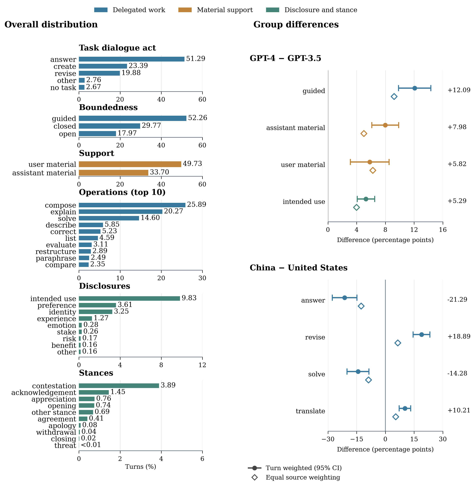

# TBSODS

**Characterizing human-LLM delegation: a turn-level annotation framework and resource**

Companion resource for the manuscript by **Tianyi Liang, Chloé Clavel, Jean-Philippe Cointet, and Carlo Santagiustina**.

TBSODS describes user turns along six dimensions: **Task dialogue act, Boundedness, Support, Operations, Disclosures, and Stances**. This repository contains the complete 58-label taxonomy, annotation codebook and historical prompts with publication-aligned field names, **207,047 automatically annotated user turns from 63,559 education-related WildChat conversations**, and the analysis and plotting code for the paper's descriptive analyses and applications.


## Contents

| Path | Contents |
| --- | --- |
| [`taxonomy/`](taxonomy/) | Full definitions, all 58 labels, codebook, name-aligned historical annotation prompt/schema and education-relevance prompt |
| [`data/annotated_turns/`](data/annotated_turns/) | 14 Parquet shards with 16 fields: user text, preceding assistant context, education relevance, six annotation axes, compact source locators and conversation metadata |
| [`data/DATA_CARD.md`](data/DATA_CARD.md) | Corpus selection, provenance, scope and known annotation issues |
| [`data/DATA_DICTIONARY.md`](data/DATA_DICTIONARY.md) | Field definitions, index conventions and missing values |
| [`data/frozen/`](data/frozen/) | Text-free historical selection decisions and turn annotations used for exact reconstruction |
| [`data/SOURCE.json`](data/SOURCE.json) | Pinned WildChat revision, model provenance and corpus counts |
| [`figures/`](figures/) | Nine PNG figures and the calculation/plotting scripts needed to reproduce them |
| [`figures/README.md`](figures/README.md) | Mapping from the current paper to each figure and analysis; framework illustrations |
| [`scripts/lookup_source.py`](scripts/lookup_source.py) | Recover the original full WildChat conversation from its source locator |
| [`scripts/rebuild_dataset.py`](scripts/rebuild_dataset.py) | Rebuild all 16 fields from raw WildChat and the frozen layer |
| [`REPRODUCIBILITY.md`](REPRODUCIBILITY.md) | Source download, exact reconstruction and analysis commands |

## Quick start

```bash
git clone https://github.com/TimmyLTY/tbsods.git
cd tbsods
```

Use Python 3.12 or later; the pinned environment was exercised with Python 3.14.7.

```bash
python -m venv .venv
source .venv/bin/activate
python -m pip install -r requirements.txt
python scripts/reproduce.py
```

The command recomputes all nine analysis figures directly from the released Parquet files, including regression estimates and the 5,000-replicate repeated-use bootstrap. It writes **PNG only** to `figures/`. Intermediate tables are created in a temporary directory and removed when the run finishes. To retain them, run `python scripts/reproduce.py --results-dir results`. No model API calls, raw WildChat download or precomputed analysis results are required for this command. Framework illustrations are supplied separately in `figures/framework/`.

| Scripts in `figures/` | PNG outputs |
| --- | --- |
| `descriptive/` | `delegation_combined.png` |
| `feedback/` | `feedback_cooccurrence.png`, `feedback_contestation.png`, `feedback_appreciation.png`, `feedback_positive_feedback.png` |
| `boundedness/` | `boundedness_cooccurrence.png`, `boundedness_overall_contestation.png`, `boundedness_overall_appreciation.png` |
| `longitudinal/` | `repeated_use_stances.png` |

Task dialogue act percentages use all 207,047 turns; boundedness uses 200,930 task turns with recorded values; the other axes use 201,525 task turns. Multi-label rates can sum to more than 100%. The descriptive figure displays eight contrasts across **GPT-4 versus GPT-3.5** and **China versus the United States**, using different horizontal scales for legibility. Inference retains the original 232-test BH family and source-clustered confidence intervals. The regional and language-environment tests remain in that original calculation, but are not displayed. Country groups are fixed in `figures/descriptive/country_mapping.csv`, derived from Unicode CLDR 44; the historical region variable also remains a control in the feedback models.

Sequential feedback analyses use 138,466 strictly consecutive task-origin pairs; boundedness requires a recorded origin label, leaving 138,027 pairs. Positive feedback is the union of appreciation, acknowledgement and agreement. The repeated-use figure uses 200 source proxies with eligible pairs in all ten relative-order bins; intervals resample whole sources 5,000 times. The calculation scripts preserve the paper's estimators and controls.

The original WildChat files are needed for full-conversation retrieval and for dataset reconstruction. They are not needed to read the supplied annotated turns or reproduce their analysis figures.

## Rebuild the dataset from WildChat

Download the pinned WildChat source described in [REPRODUCIBILITY.md](REPRODUCIBILITY.md), then run:

```bash
python scripts/rebuild_dataset.py \
  --wildchat-dir raw/WildChat-1M/data \
  --output-dir rebuilt/annotated_turns \
  --verify-against data/annotated_turns
```

This combines the original messages and conversation metadata with the frozen selection and annotation results. The optional verification compares every row and all 16 fields with the supplied resource. It performs no model inference. Re-running the historical classifiers is a separate workflow and is not included in this first release. Existing labels, missing values and gaps in retained turn indices are preserved.

## Read the annotations

```python
import pandas as pd

turns = pd.read_parquet("data/annotated_turns")
print(turns[["conversation_id", "turn_index", "current_user_turn",
             "task_dialogue_act", "boundedness", "operations"]].head())
```

One row is one retained **user message**. `task_dialogue_act` is a scalar, `boundedness` is nullable, and `support`, `operations`, `disclosures`, and `stances` are arrays. Array order retains the original annotation output; statistical comparisons treat them as label sets.

- `conversation_id` encodes the original WildChat **shard filename:row index**. Together with the zero-based raw-user `turn_index`, it locates the conversation and exact message without extra source fields.
- `timestamp` is the conversation's last-turn UTC time, not an individual user-message sending time.
- `country`, `state`, `userid` and `model` use the conversation-level metadata underlying the paper. `userid` retains the existing analysis encoding of the modal hashed-IP proxy; it is not a verified person or account. No new hash is calculated.
- Derived sequence ranks, operation counts and missingness flags are calculated when needed. Repeated language fields are omitted. `previous_assistant_turn` retains the annotation context, and `education_relevance` retains the conversation selection category; full history remains retrievable through the locator.

See the [data dictionary](data/DATA_DICTIONARY.md) before joining or aggregating metadata.

## Taxonomy and annotation

Start with the [codebook](taxonomy/CODEBOOK.md). Fields use `task_dialogue_act` (Task dialogue act) and `boundedness` (Boundedness) throughout the release. The historical prompt and schema are name-aligned transcriptions; annotation values, definitions and decision rules are unchanged. The annotation unit is the current user turn, using only the immediately preceding assistant response as context. The resource is an automatic **silver annotation layer**, not a human-adjudicated corpus. The frozen run includes 595 task-present turns with missing boundedness; they are preserved and excluded only from analyses requiring a recorded boundedness label.

The human-reference concordance table in the manuscript is a separate validation artifact. The human reference workbooks are not included in this turn-resource release and are not replaced by the silver annotations.

## Source and citation

The source is the non-toxic [`allenai/WildChat-1M`](https://huggingface.co/datasets/allenai/WildChat-1M/tree/7d6490e462285cf85d91eabea0f9a954fbddcd1f) training split at the revision recorded in the manuscript. Source attribution and third-party notices are in [NOTICE.md](NOTICE.md). Cite both TBSODS and WildChat; see [CITATION.cff](CITATION.cff) and [references.bib](references.bib). Repository citation metadata is provided in `CITATION.cff`.



## License

Code is licensed under MIT; original annotations, documentation, taxonomy and illustrations under CC BY 4.0; and the WildChat-derived database under ODC-BY 1.0. Unicode-derived mapping data retains its existing license. See [LICENSE.md](LICENSE.md) for component scopes and [NOTICE.md](NOTICE.md) for source attribution.
